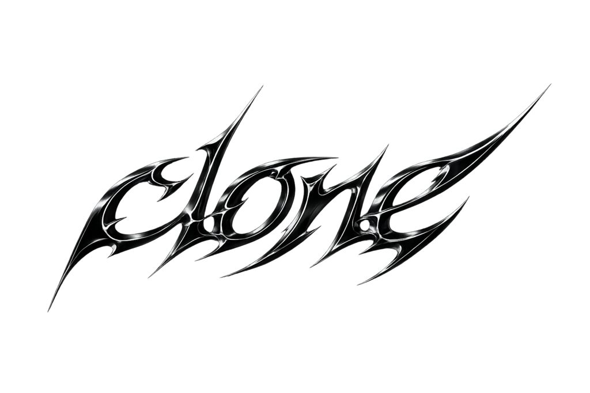

# personal scripts and tools
these r my personal scripts I've made or collected over some time


## Install

Copy the scripts or macros you want into the matching 3ds Max ENU folders:

```text
%USERPROFILE%\AppData\Local\Autodesk\3dsMax\<version>\ENU\scripts\
%USERPROFILE%\AppData\Local\Autodesk\3dsMax\<version>\ENU\usermacros\
```

Some tools use the shared UI helper:

```text
Utilities\CloneUI.ms
images\Logo.png
```

Keep those available under `scripts\CloneTools\` when deploying the styled tools.

## Materials

- `PowerShader.ms` - Material search, creation, and instancing workflow with drag-to-viewport support.
- `GLTF_Maker.ms` - Builds GLTF/USD Preview Surface materials from texture folders.
- `TextureFolderPalette.ms` - Creates material palettes from texture directories.
- `Offset_Material_IDs.ms` - Offsets material ID values on selected objects.
- `PropagateMaterial.ms` - Converts detached multi-material assignments into direct materials.

## Rigging

- `clone_cc_to_biped.ms` - Drag onto a viewport: fits a Biped to a Reallusion/Character Creator (`CC_Base_*`) rig and drives it. Runs the Character Creator preset of `Clone_UE_To_BIPED.ms`, so keep both files together.
- `Clone_UE_To_BIPED.ms` - UI-driven skeleton-to-Biped remapper with Unreal and Character Creator presets. Fits the Biped from joint positions, constrains the source bones, and reports joint offsets and bind drift in the Listener.
- `UE5_Mixamo_BoneSwapper.ms` - Swaps UE5 and Mixamo bone names.
- `MergeDuplicateSkeletons.ms` - Merges duplicate skeleton copies into one master rig (`root` / `Rig.001_*` or Genesis `hip`).
- `Clone_Genesis9_Importer.ms` - Drag onto a viewport after importing a DAZ Genesis 9 FBX: merges the per-figure skeletons (eyes, mouth, tear, lashes, clothing) into the body, fits a Biped and constrains the Genesis bones to it. Skin weights are untouched.

## Utilities

- `ActivateManualRetopo.mcr` - Enables a selected object as a live retopology surface.
- `autoLogo.ms` - Batch processes SVG logo assets into 3D geometry.
- `Collapse.ms` - Collapses modifier stacks while preserving selected modifiers.
- `CopyUV0toUV1.ms` / `CopyUVChannels.ms` - Copies UV data between channels.
- `CloneTools-DecimateVertChain.ms` / `CloneTools-EqualizeVertChain.ms` - Decimates or evenly spaces vertices along a selected Editable Poly chain.
- `CloneTools-GroupsToDummies.mcr` - Converts selected groups into dummy hierarchies.
- `CloneTools-ImportObsidianCanvasImages.mcr` - Imports images from an Obsidian `.canvas` file as reference planes.
- `CloneTools-InstanceFromFirstKeepMaterials.mcr` - Replaces selected objects with instances of the first selected source while preserving each target material.
- `CloneTools-MakeEdgeHard.mcr` / `CloneTools-MakeEdgeSmooth.mcr` - Marks selected poly edges hard or smooth.
- `CloneTools-PasteClipboardImagePlane.mcr` - Pastes a clipboard image or file path as a viewport-aligned unlit reference plane.
- `CloneTools-QuickConnectNodes.mcr` / `connector.ms` / `connector_rules.ms` - Auto-connects selected Slate Material Editor texture maps to material slots by naming rules.
- `CloneTools-ReadOptimizeData.mcr` - Applies a default Optimize modifier preset to selected objects.
- `CloneTools-RotationAxisSnap.mcr` - Blender-style viewport rotation axis snapping (with Grid-aligned view support).
- `CloneTools-SendBitmapToVCanvas.mcr` - Sends a bitmap to Viewport Canvas.
- `CloneTools-SplineArc.ms` / `CloneTools-SplineDivide.ms` - Bulges a 2-knot spline segment into a G1 arc or bakes interpolation steps into real knots.
- `CloneTools-SwapViewports.mcr` - Swaps left and right viewport layouts.
- `CloneTools-TogglePerspIsoView.mcr` - Toggles between Perspective and Orthographic/Iso user view.
- `CloneTools-ToggleWireColorBlackRandom.mcr` - Toggles selected objects' wireframe colors between black and random.
- `CloneTools-ViewportPresetClone.mcr` / `CloneTools-ViewportPresetCloneWhite.mcr` - Applies custom Nitrous viewport visual presets.
- `ViewportOpacitySlider.ms` / `CloneTools-ViewportOpacitySlider.mcr` - Click-drag viewport opacity control.
- `ViewportTimeSlider.ms` / `CloneTools-ViewportTimeSlider.mcr` - Click-drag timeline scrubbing from the viewport.
- `ToggleTrackView.ms` - Toggles Track View modes.

## SME

- `OSL_SME_DropHandler.ms` - Changes Slate drag/drop texture behavior to OSL Bitmap (by Changsoo Eun).
- `SME_RandomizeBitmapNames.ms` - Adds random seed values to bitmap node names.

## MaxToBodypaint

- `MaxToBodypaint.ms` / `MaxToBodypaint.pyp` - One-click bridge sending selected 3ds Max meshes (evaluated with UVs and material maps) straight into Cinema 4D / BodyPaint. See [MaxToBodypaint/README.md](MaxToBodypaint/README.md).

## iClone

- `CloneFBX.py` - Lightweight iClone avatar FBX exporter with presets and root-bone merging.
- `MaxSYNC/` (`MaxSYNC.py`, `MaxSyncListener.ms`, `MaxSyncListenerPy.py`, `MaxSyncMacros.ms`) - Bidirectional iClone ↔ 3ds Max live link for avatar animation and prop transfer. (probably broken)

## ImageMagick

- `ConvertToJPEG.bat`, `EXR_to_HDR.bat`, `EXR_to_RGBM.bat`, `CombineMapsAdditive.bat` - Drag-and-drop image conversion and mask utilities.
- `Cubemap_Maker/` - Generates horizontal-cross cubemaps from face images.
- `ImageQuickResize/` - Batch resizes texture bakes. See [ImageMagick/README.md](ImageMagick/README.md).

## Requirements

- Autodesk 3ds Max 2024 or newer.

## License

MIT License
